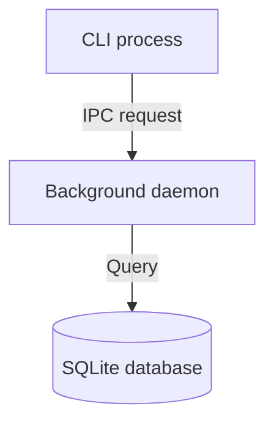

# Technical documentation reference guide

Reference specifications, formatting patterns, and validation rules for authoring documentation on the documentation platform (`site/`, `@devtools/site`). Consult this guide when writing Diátaxis documents or configuring Fumadocs MDX components. See [.agents/skills/documentation-authoring/SKILL.md](.agents/skills/documentation-authoring/SKILL.md) for the operational workflow.

## Diátaxis quadrant specifications

The Diátaxis framework divides documentation into four quadrants based on reader intent. Each quadrant maintains distinct content boundaries, structures, and tone.

### 1. Tutorial

Tutorials guide beginners through a learning process to produce a concrete working outcome.

- **Reader mindset**: A newcomer seeking guided instruction.
- **Pedagogical goal**: Learning through practical action.
- **Structure**:
  1. Introduction stating what the user will build.
  2. Prerequisites listing required software and setup.
  3. Ordered steps with code snippets and immediate execution commands.
  4. Expected output showing terminal or visual results after each step.
  5. Conclusion confirming successful completion.
- **Rules**:
  - Keep instructions strictly linear with a single path.
  - Explain the concrete action rather than deep system theory.
  - Focus on the primary path. Omit alternative tools and configuration branches.
  - Test every command in sequence from a clean environment.
- **File location**: `site/content/docs/tutorials/<topic>.mdx`

### 2. How-to guide

How-to guides help developers solve a specific practical problem or accomplish a targeted task.

- **Reader mindset**: A practitioner with a concrete goal asking how to solve a problem.
- **Pedagogical goal**: Completing a specific task efficiently.
- **Structure**:
  1. Direct statement of the task and expected outcome in the opening sentence.
  2. Concrete prerequisites (for example, running daemon, installed CLI).
  3. Action steps ordered logically toward the outcome.
  4. Validation step verifying the solution works as intended.
- **Rules**:
  - Focus strictly on a single operational task.
  - Address real-world edge cases relevant to the task.
  - Link to tutorials or explanations for introductory setup.
  - Use imperative verbs for step titles (for example, "Configure daemon port", "Generate Lighthouse report").
- **File location**: `site/content/docs/how-to/<topic>.mdx`

### 3. Reference

Reference documents provide authoritative and complete technical specifications.

- **Reader mindset**: A developer seeking exact facts, parameters, types, or configuration keys.
- **Pedagogical goal**: Providing factual information on demand.
- **Structure**:
  1. Name and short definition of the subject.
  2. Syntax or signature specification.
  3. Structured tables of arguments, flags, environment variables, or schema fields.
  4. Return types and possible error codes.
  5. Minimal copy-pasteable usage example.
- **Rules**:
  - Maintain a factual and uniform layout across pages.
  - List all options exhaustively, including default values, constraints, and types.
  - Focus on technical specifications and syntax. Omit tutorials and conceptual discussions.
  - Keep examples minimal and focused strictly on syntax.
- **File location**: `site/content/docs/reference/<topic>.mdx`

### 4. Explanation

Explanations illuminate architecture and technical decisions.

- **Reader mindset**: A developer or contributor seeking deeper understanding of system design.
- **Pedagogical goal**: Building architectural comprehension and contextual awareness.
- **Structure**:
  1. Context defining the concept, subsystem, or architectural pattern.
  2. Architectural overview with system topology or data flow diagrams.
  3. Discussion of trade-offs and alternative designs.
  4. Connection to related subsystems and runtime behaviors.
- **Rules**:
  - Focus on system rationale and architectural context.
  - Include diagrams for process topologies and state transitions.
  - Detail trade-offs explicitly without marketing language.
  - Link to how-to guides for operational procedures.
- **File location**: `site/content/docs/explanation/<topic>.mdx`

## Fumadocs MDX syntax rules

Fumadocs processes MDX files using Next.js and custom components. Follow these formatting rules for clean rendering.

### Frontmatter

Every MDX document begins with YAML frontmatter bounded by `---`:

```yaml
---
title: Daemon architecture
description: Process topology, IPC communication, and lifecycle management of the DevTools background daemon.
icon: Server
full: false
---
```

- `title`: String in sentence case. Fumadocs renders this as the page H1 heading.
- `description`: String providing a clear, one-sentence summary for search indexes and page metadata.
- `icon`: Optional Lucide icon name matching sidebar navigation themes.
- `full`: Optional boolean. Set to `true` only for wide data tables or custom layout pages.

### Headings

- Start the body with level 2 headings (`##`). Do not include level 1 headings (`#`) in the body text.
- Follow strict monotonic nesting: `##` followed by `###`, followed by `####`. Never skip levels.
- Apply sentence case to all headings.
- Avoid trailing colons or punctuation in headings.

### Code blocks

Always specify an explicit language identifier on code fences:

````mdx
```bash
bun --filter @devtools/cli dev
```
````

For file references, add a `title` attribute specifying the relative path:

````mdx
```ts title="apps/cli/src/daemon.ts"
export async function startDaemon(port: number): Promise<void> {
  // Implementation
}
```
````

Line highlighting uses curly braces:

````mdx
```ts {2-3} title="packages/core/src/config.ts"
export interface Config {
  port: number;
  host: string;
}
```
````

### Admonitions and callouts

Use standard GitHub alert syntax for simple callouts:

```markdown
> [!NOTE]
> The daemon runs on localhost port 3000 by default.

> [!TIP]
> Pass the `--verbose` flag to inspect HTTP payload headers.

> [!IMPORTANT]
> Bun version 1.2 or higher is required to run the workspace.

> [!WARNING]
> Changing the database path invalidates active worker sessions.

> [!CAUTION]
> Deleting this directory permanently clears local audit history.
```

For custom callout titles, use the Fumadocs `Callout` component:

```mdx
import { Callout } from 'fumadocs-ui/components/callout';

<Callout type="warn" title="Port conflict">
  If port 3000 is occupied, the daemon selects the next available port automatically.
</Callout>
```

### Interactive components

Import Fumadocs components at the top of the MDX file or directly before use:

#### Tabs

```mdx
import { Tab, Tabs } from 'fumadocs-ui/components/tabs';

<Tabs items={['Bun', 'CLI binary']}>
  <Tab value="Bun">
    ```bash
    bun run devtools web
    ```
  </Tab>
  <Tab value="CLI binary">
    ```bash
    ./dist/devtools web
    ```
  </Tab>
</Tabs>
```

#### Steps

```mdx
import { Step, Steps } from 'fumadocs-ui/components/steps';

<Steps>
  <Step>
    ### Install prerequisites
    Install Bun and clone the repository.
  </Step>
  <Step>
    ### Start the daemon
    Run `bun run devtools daemon start` to initialize background services.
  </Step>
</Steps>
```

#### Cards and card grids

```mdx
import { Card, Cards } from 'fumadocs-ui/components/card';

<Cards>
  <Card
    title="Getting started"
    href="/docs/tutorials/getting-started"
    description="Learn the fundamentals of DevTools in five minutes."
  />
  <Card
    title="CLI reference"
    href="/docs/reference/cli"
    description="Complete listing of flags, options, and commands."
  />
</Cards>
```

### Diagrams

Use Mermaid code fences for architecture and sequence diagrams. Always quote node labels containing spaces or special characters:

````mdx

````

## Accessibility validation procedures

Verify all documentation content against accessibility invariants before publishing:

### 1. Image alternative text

- Every image element (``) must contain meaningful alt text.
- Describe the visual data, workflow, or structure shown in the image.
- Never leave alt text empty (`alt=""`), and never use file names (such as `diagram.png`) or generic phrases (such as "screenshot" or "image").
- Keep descriptions concise and informative.

### 2. Heading hierarchy

- Verify that heading levels form a continuous sequence without gaps.
- Screen readers rely on heading levels for page outlines; jumping from `##` to `####` breaks navigation.
- Give every section a descriptive heading.

### 3. Descriptive links

- Link anchor text must describe the destination resource.
- Acceptable: `Read the [daemon reference guide](/docs/reference/daemon)`.
- Prohibited: `To read more, click [here](/docs/reference/daemon)`.
- Never insert bare URLs into prose text. Wrap URLs in descriptive markdown links.

### 4. Code block labeling

- Screen readers announce code block language identifiers.
- Never leave code fences unlabeled (without a language tag).
- For terminal commands, use `bash` or `sh`. For output blocks, use `text`.

### 5. Table semantic structure

- Markdown tables must contain a header row separated from body rows by a divider line (`| --- | --- |`).
- Keep tables focused. Do not nest complex Markdown inside table cells.

## Diagnostic resolution for compilation

When build verification commands in [SKILL.md](.agents/skills/documentation-authoring/SKILL.md) report errors, resolve them using these diagnostic procedures:

| Error message or symptom | Underlying cause | Resolution |
| ------------------------ | ---------------- | ---------- |
| `Page not found` or broken link warning | Relative link target does not match any valid content route | Verify the target slug against the directory tree under `site/content/docs/`. Update the link to use the route path (for example, `/docs/tutorials/getting-started`). |
| `Expected corresponding JSX closing tag` | An unclosed HTML or JSX tag exists in the MDX file | Check all custom components and HTML tags (``, `<br>`, `<Tabs>`). Close every tag explicitly or self-terminate it (`<Component />`). |
| `Missing title in frontmatter` | Frontmatter block is missing or lacks the `title` field | Add `title: <Page Title>` to the YAML frontmatter block at the top of the file. |
| `YAML Parse Error` | Malformed YAML syntax or unquoted special characters | Check indentation in the frontmatter block. Enclose strings containing colons or quotes in quotation marks. |
| `Cannot find module 'fumadocs-ui/...'` | Missing or incorrect component import path | Verify the import path matches standard Fumadocs UI exports (`fumadocs-ui/components/<component>`). |
