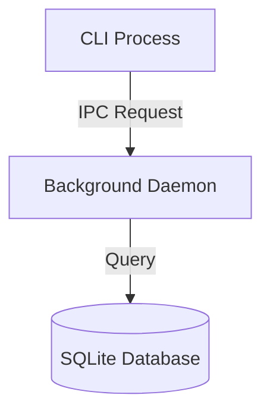

# Fumadocs Features and Styling Reference

Authoritative technical reference for MDX features, built-in UI components, code highlighting, page tree configuration, and styling across the documentation platform (`site/`, `@devtools/site`).

Official documentation:
- [Fumadocs Overview](https://fumadocs.dev/)
- [Fumadocs UI Components](https://fumadocs.dev/docs/ui/components)
- [Fumadocs MDX Plugins and Markdown](https://fumadocs.dev/docs/ui/markdown)
- [Fumadocs Page Tree and Meta](https://fumadocs.dev/docs/headless/source-api/page-tree)

---

## 1. Page tree and navigation structure (`meta.json`)

Fumadocs uses `meta.json` files within directory hierarchies under `content/docs/` to configure navigation order, display names, icons, and tabbed section roots.

### 1.1 Root configuration (`meta.json`)

To configure top-level documentation sections as separate tabs/modes, place `meta.json` in the root and in each section directory.

```json title="content/docs/meta.json"
{
  "title": "Documentation",
  "pages": ["tutorials", "how-to", "reference", "explanation"]
}
```

```json title="content/docs/tutorials/meta.json"
{
  "title": "Tutorials",
  "description": "Learning-oriented guides",
  "root": true,
  "icon": "GraduationCap",
  "pages": ["index", "getting-started"]
}
```

### 1.2 Page array syntax and operators

The `pages` property in `meta.json` controls sidebar sequence and appearance using the following operators:

| Operator | Syntax | Purpose | Example |
| --- | --- | --- | --- |
| **Exact page/folder** | `"slug"` | Places file or sub-folder at this position | `"getting-started"` |
| **Section separator** | `"---Label---"` | Inserts a non-clickable section header line in the sidebar | `"---Development---"` |
| **Separator with icon** | `"---[Icon]Label---"` | Inserts a section header line with a Lucide icon | `"---[Wrench]Tools---"` |
| **Rest wildcard** | `"..."` | Appends all unlisted files in alphabetical order | `"..."` |
| **Reverse rest** | `"z...a"` | Appends all unlisted files in reverse alphabetical order | `"z...a"` |
| **Extract folder** | `"...folder"` | Flattens sub-folder items directly into the current sidebar level | `"...(setup)"` |
| **Exclude item** | `"!slug"` | Omits a page or folder from the sidebar tree | `"!draft-page"` |
| **External link** | `"[Label](url)"` | Inserts an external hyperlink into the sidebar navigation | `"[GitHub](https://github.com/AhmedHanye/devtools)"` |
| **External link with icon** | `"[Icon][Label](url)"` | Inserts an external hyperlink with a Lucide icon | `"[Github][Source](https://github.com/...)"` |

---

## 2. Frontmatter metadata schema

Every MDX document begins with YAML frontmatter bounded by `---`:

```yaml
---
title: Page Title
description: A concise summary of the page purpose.
icon: LucideIconName
full: false
---
```

| Field | Type | Description |
| --- | --- | --- |
| `title` | `string` | Page heading rendered as H1. Displayed in sidebar and search results. |
| `description` | `string` | Summary used for metadata, OpenGraph, search previews, and card summaries. |
| `icon` | `string` | Name of a Lucide icon (for example `Server`, `Terminal`, `Database`, `Layers`). |
| `full` | `boolean` | When `true`, disables sidebar margins to display full-width content. |

---

## 3. Built-in Fumadocs UI components

Fumadocs provides specialized documentation components imported from `fumadocs-ui/components/<name>`.

### 3.1 Callouts

Highlight notes, tips, warnings, and alerts. Supports GitHub blockquote syntax or the custom `<Callout>` component.

#### GitHub alert syntax:

```markdown
> [!NOTE]
> Informational guidance and general notes.

> [!TIP]
> Helpful recommendations or optimization advice.

> [!IMPORTANT]
> Critical prerequisites or must-know instructions.

> [!WARNING]
> Warnings regarding potential breaking changes or conflicts.

> [!CAUTION]
> High-risk operations that may cause data loss.
```

#### Custom `<Callout>` component:

```mdx
import { Callout } from "fumadocs-ui/components/callout";

<Callout type="warn" title="Port collision">
  If port 3000 is occupied, configure an alternative port via `--port`.
</Callout>;
```

Supported `type` values: `"info"` (default), `"warn"`, `"error"`.

---

### 3.2 Tabs (`<Tabs>` & `<Tab>`)

Display switchable alternatives such as package managers or operating system instructions.

```mdx
import { Tab, Tabs } from "fumadocs-ui/components/tabs";

<Tabs items={["Bun", "Binary"]}>
  <Tab value="Bun">```bash bun run devtools web ```</Tab>
  <Tab value="Binary">```bash ./dist/devtools web ```</Tab>
</Tabs>;
```

Key props:

- `items`: `string[]` - tab label array matching `value` on child `<Tab>` components.
- `groupId`: `string` - synchronizes tab selection across multiple code blocks on the same page.
- `persist`: `boolean` - saves user selection in localStorage.

---

### 3.3 Steps (`<Steps>` & `<Step>`)

Render structured step-by-step procedures with numbered step circles.

```mdx
import { Step, Steps } from "fumadocs-ui/components/steps";

<Steps>
  <Step>
    ### Install dependencies
    Clone repository and install workspace packages using Bun.
  </Step>
  <Step>
    ### Start daemon
    Run the background service to bind loopback sockets.
  </Step>
</Steps>;
```

---

### 3.4 Cards and card grids (`<Cards>` & `<Card>`)

Render navigational cards linking to pages or external resources.

```mdx
import { Card, Cards } from "fumadocs-ui/components/card";

<Cards>
  <Card
    title="CLI Reference"
    href="/docs/reference/cli"
    description="Commands, flags, and exit codes for devtools."
  />
  <Card
    title="Daemon Architecture"
    href="/docs/explanation/daemon-architecture"
    description="Process topology and IPC specifications."
  />
</Cards>;
```

---

### 3.5 Accordions (`<Accordions>` & `<Accordion>`)

Collapsible disclosure elements for FAQs or deep implementation details.

```mdx
import { Accordion, Accordions } from "fumadocs-ui/components/accordion";

<Accordions>
  <Accordion title="Where are database files stored?">
    SQLite files are stored in `~/.devtools/data.db` with WAL mode enabled.
  </Accordion>
  <Accordion title="How do I change the default port?">
    Specify the `DEVTOOLS_PORT` environment variable or `--port <number>` flag.
  </Accordion>
</Accordions>;
```

---

### 3.6 File tree (`<Files>`, `<Folder>`, `<File>`)

Display directory hierarchies and file trees with folder icons.

```mdx
import { File, Folder, Files } from "fumadocs-ui/components/files";

<Files>
  <Folder name="apps">
    <Folder name="cli">
      <File name="package.json" />
    </Folder>
  </Folder>
  <Folder name="packages">
    <Folder name="core">
      <File name="src/index.ts" />
    </Folder>
  </Folder>
  <File name="package.json" />
</Files>;
```

---

### 3.7 Type tables (`<TypeTable>`)

Render clean documentation tables for TypeScript props, options, and schemas.

```mdx
import { TypeTable } from "fumadocs-ui/components/type-table";

<TypeTable
  type={{
    port: {
      description: "Network port bound by the loopback daemon",
      type: "number",
      default: "3000",
    },
    host: {
      description: "Loopback interface binding host",
      type: "string",
      default: '"127.0.0.1"',
    },
  }}
/>;
```

---

### 3.8 Image zoom (`<ImageZoom>`)

Enables click-to-zoom modal behavior for diagrams and screenshots.

```mdx
import { ImageZoom } from "fumadocs-ui/components/image-zoom";

<ImageZoom
  src="/diagram.png"
  alt="Architecture diagram"
  width={800}
  height={400}
/>;
```

---

## 4. Code block highlighting and Shiki features

Fumadocs uses Shiki for server-side syntax highlighting.

### 4.1 Fenced code block metadata

- **Language identifier**: Always specify the language (`bash`, `ts`, `tsx`, `json`, `yaml`, `text`).
- **File title**: Use `title="path/to/file"` to render the filename tab above the code block:
  ````mdx
  ```ts title="apps/cli/src/daemon.ts"
  export async function start() {}
  ```
  ````
- **Line numbers**: Add `showLineNumbers` to display line counters.
- **Line highlighting**: Use curly braces `{1, 3-5}` to highlight line numbers:
  ````mdx
  ```ts {2-3} title="config.ts"
  const host = "127.0.0.1";
  const port = 3000;
  ```
  ````

### 4.2 Shiki inline transformer comments

Use inline annotations for granular line and word highlights:

- `// [!code highlight]` - Highlights the current line.
- `// [!code word:keyword]` - Highlights specific words in the block.
- `// [!code ++]` - Green diff insertion line.
- `// [!code --]` - Red diff deletion line.
- `// [!code focus]` - Focuses on the current line while dimming surrounding code.

---

## 5. Diagrams and Math (KaTeX & Mermaid)

### 5.1 Mermaid diagrams

Diagrams are authored using fenced code blocks with language `mermaid`:

````mdx

````

Rules:

- Quote node labels containing spaces or parentheses (for example `Node["Label (Details)"]`).
- Avoid raw HTML tags inside node labels.

### 5.2 Math and LaTeX formulas

Inline math uses `$...$` or `\(...\)`. Display math uses `$$...$$` or `\[...\]`:

```markdown
Euler's formula states that $e^{i\pi} + 1 = 0$.

$$
\int_{-\infty}^{\infty} e^{-x^2} dx = \sqrt{\pi}
$$
```

---

## 6. Styling, themes, and CSS variables

Fumadocs provides semantic CSS custom properties in `fumadocs-ui/css/neutral.css` and `fumadocs-ui/css/preset.css`.

### 6.1 Core theme tokens

- `--color-fd-background` / `--color-fd-foreground`
- `--color-fd-primary` / `--color-fd-primary-foreground`
- `--color-fd-muted` / `--color-fd-muted-foreground`
- `--color-fd-card` / `--color-fd-card-foreground`
- `--color-fd-border` / `--color-fd-accent`

### 6.2 Quadrant color tokens

Section colors are injected via `:root` and `.dark` CSS tokens to colorize tabs and sidebar active indicators:

```css
:root {
  --tutorials-color: hsl(217, 100%, 58%);
  --how-to-color: hsl(158, 75%, 40%);
  --reference-color: hsl(38, 92%, 50%);
  --explanation-color: hsl(270, 75%, 55%);
}

.dark {
  --tutorials-color: #93c5fd;
  --how-to-color: #6ee7b7;
  --reference-color: #fde047;
  --explanation-color: #d8b4fe;
}
```
