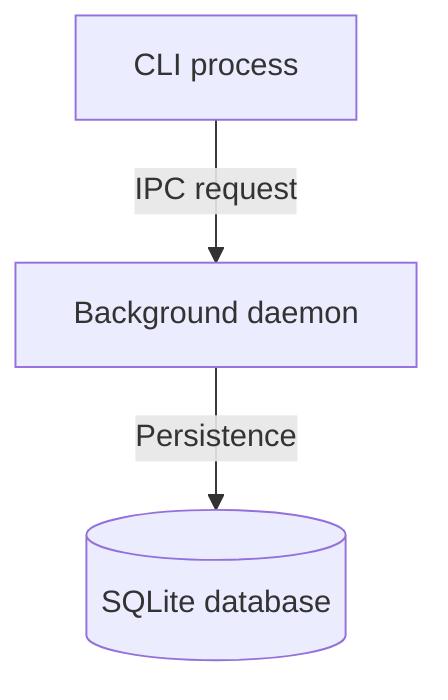

# Fumadocs features and styling reference

Authoritative technical reference for MDX features, built-in UI components, code highlighting, page tree configuration, layouts, plugins, and visual styling across the documentation platform (`site/`, `@devtools/site`).

Official documentation:
- [Fumadocs overview](https://fumadocs.dev/)
- [Fumadocs UI components](https://fumadocs.dev/docs/ui/components)
- [Fumadocs MDX plugins and markdown](https://fumadocs.dev/docs/ui/markdown)
- [Fumadocs page tree and meta](https://fumadocs.dev/docs/headless/source-api/page-tree)

---

## 1. Page tree and navigation structure (`meta.json`)

Fumadocs uses `meta.json` files within directory hierarchies under `content/docs/` to configure navigation order, display names, icons, root section tabs, and folder behavior.

### 1.1 Root configuration (`meta.json`)

To configure top-level documentation sections as separate tabs or modes, place `meta.json` in the content root and in each section directory.

```json title="content/docs/meta.json"
{
  "title": "Documentation",
  "pages": ["tutorials", "how-to", "reference", "explanation"]
}
```

```json title="content/docs/tutorials/meta.json"
{
  "title": "Tutorials",
  "description": "Learning-oriented guides",
  "root": true,
  "icon": "GraduationCap",
  "defaultOpen": true,
  "collapsible": true,
  "pages": ["index", "getting-started"]
}
```

#### Supported `meta.json` properties

| Property | Type | Description |
| --- | --- | --- |
| `title` | `string` | Display label of the section folder in the sidebar. |
| `description` | `string` | Summary used for metadata, OpenGraph, search previews, and card summaries. |
| `icon` | `string` | Name of a Lucide icon (such as `GraduationCap`, `Wrench`, `BookOpen`, `Server`). |
| `root` | `boolean \| string` | When `true`, elevates the folder to a top-level tab or section root. Also accepts a version string (such as `"v2"`). |
| `defaultOpen` | `boolean` | When `true`, expands the folder by default on page load. |
| `collapsible` | `boolean` | When `false`, locks the folder open. |
| `pages` | `string[]` | Ordered array defining sequence, separators, wildcards, and external links. |
| `pagesIndex` | `string` | Custom slug specifying which page serves as the folder index. |

### 1.2 Page array syntax and operators

The `pages` property in `meta.json` controls sidebar sequence and appearance using the following operators:

| Operator | Syntax | Purpose | Example |
| --- | --- | --- | --- |
| **Exact page or folder** | `"slug"` | Places file or sub-folder at this position | `"getting-started"` |
| **Section separator** | `"---Label---"` | Inserts a non-clickable section header line in the sidebar | `"---Development---"` |
| **Separator with icon** | `"---[Icon]Label---"` | Inserts a section header line with a Lucide icon | `"---[Wrench]Tools---"` |
| **Empty divider** | `"---"` | Inserts a subtle horizontal line without text | `"---"` |
| **Rest wildcard** | `"..."` | Appends all unlisted files in alphabetical order | `"..."` |
| **Reverse rest** | `"z...a"` | Appends all unlisted files in reverse alphabetical order | `"z...a"` |
| **Extract folder** | `"...folder"` | Flattens sub-folder items directly into the current sidebar level | `"...(setup)"` |
| **Exclude item** | `"!slug"` | Omits a page or folder from the sidebar tree | `"!draft-page"` |
| **External link** | `"[Label](url)"` | Inserts an external hyperlink into the sidebar navigation | `"[GitHub](https://github.com/AhmedHanye/devtools)"` |
| **External link with icon** | `"[Icon][Label](url)"` | Inserts an external hyperlink with a Lucide icon | `"[Github][Source](https://github.com/...)"` |
| **Forced external link** | `"external:[Label](url)"` | Forces external link behavior (`target="_blank"`) | `"external:[Status](https://status.dev)"` |

---

## 2. Frontmatter metadata schema

Every MDX document begins with YAML frontmatter bounded by `---`:

```yaml
---
title: Page title
description: A concise summary of the page purpose.
icon: LucideIconName
status: beta
full: false
---
```

| Field | Type | Description |
| --- | --- | --- |
| `title` | `string` | Page heading rendered as H1. Displayed in sidebar and search results. |
| `description` | `string` | Summary used for metadata, OpenGraph, search previews, and card summaries. |
| `icon` | `string` | Name of a Lucide icon (such as `Server`, `Terminal`, `Database`, `Layers`). |
| `status` | `string` | Status badge in the sidebar when `statusBadgesPlugin` is active (`new`, `beta`, `deprecated`). |
| `full` | `boolean` | When `true`, removes max-width limits and Table of Contents for wide tables or dashboards. |

---

## 3. Built-in Fumadocs UI components

Fumadocs provides specialized documentation components imported from `fumadocs-ui/components/<name>`.

### 3.1 Callouts (`<Callout>`)

Highlights warnings, tips, errors, recommendations, and important notices.

```mdx
import { Callout } from "fumadocs-ui/components/callout";

<Callout type="warn" title="Port collision">
  If port 3000 is occupied, configure an alternative port via `--port`.
</Callout>
```

Supported `type` values:
- `"info"` (default): General notes and informational context.
- `"idea"`: Tips, shortcuts, and optimization ideas.
- `"warn"` or `"warning"`: Breaking changes, caveats, or deprecations.
- `"error"`: Dangerous operations, data loss risks, or runtime failures.
- `"success"`: Verification passes and completed states.

Subcomponents available from `fumadocs-ui/components/callout`:
- `CalloutContainer`
- `CalloutTitle`
- `CalloutDescription`

#### GitHub alert syntax alternative

Fumadocs also transforms GitHub-style blockquote alerts directly:

```markdown
> [!NOTE]
> Informational guidance and general notes.

> [!TIP]
> Helpful recommendations or optimization advice.

> [!IMPORTANT]
> Critical prerequisites or must-know instructions.

> [!WARNING]
> Warnings regarding potential breaking changes or conflicts.

> [!CAUTION]
> High-risk operations that may cause data loss.
```

### 3.2 Tabs (`<Tabs>` & `<Tab>`)

Display switchable alternatives such as package managers or operating system instructions.

```mdx
import { Tab, Tabs } from "fumadocs-ui/components/tabs";

<Tabs items={["Bun", "Binary"]} groupId="runtime-choice" persist>
  <Tab value="Bun">
    ```bash
    bun run devtools web
    ```
  </Tab>
  <Tab value="Binary">
    ```bash
    ./dist/devtools web
    ```
  </Tab>
</Tabs>
```

Key props:
- `items`: `string[]` - Tab label array.
- `groupId`: `string` - Synchronizes tab selection across multiple tab blocks on the page.
- `persist`: `boolean` - Saves selection in `localStorage`.
- `updateAnchor`: `boolean` - Updates URL hash to match active tab.
- `label`: `ReactNode` - Label text placed before tab buttons.
- `defaultIndex`: `number` - Index of the default active tab.

Subcomponents:
- `TabsList`
- `TabsTrigger`
- `TabsContent`

### 3.3 Steps (`<Steps>` & `<Step>`)

Render structured step-by-step procedures with numbered step circles and vertical timeline lines.

```mdx
import { Step, Steps } from "fumadocs-ui/components/steps";

<Steps>
  <Step>
    ### Install dependencies
    Clone repository and install workspace packages using Bun:
    ```bash
    bun install
    ```
  </Step>
  <Step>
    ### Start daemon
    Run the background service to bind loopback sockets:
    ```bash
    bun run devtools web
    ```
  </Step>
</Steps>
```

Authoring rules:
1. Always nest an `### Imperative action heading` as the first element inside each `<Step>`.
2. Follow each heading with a short 1 to 2 sentence instruction and an executable command block.

### 3.4 Cards and card grids (`<Cards>` & `<Card>`)

Render navigational cards linking to pages or external resources. Uses responsive CSS container queries (`@container`) to adjust columns.

```mdx
import { Card, Cards } from "fumadocs-ui/components/card";
import { Terminal, Database } from "lucide-react";

<Cards>
  <Card
    icon={<Terminal className="size-4" />}
    title="CLI reference"
    href="/docs/reference/cli"
    description="Commands, flags, and exit codes for devtools."
  />
  <Card
    icon={<Database className="size-4" />}
    title="Manage database"
    href="/docs/how-to/manage-database"
    description="SQLite storage files and schema migrations."
  />
</Cards>
```

Key props on `<Card>`:
- `icon`: `ReactNode` - Lucide icon rendered in an accent container.
- `title`: `ReactNode` - Concise card title (2 to 5 words).
- `description`: `ReactNode` - Short summary (1 to 2 lines).
- `href`: `string` - Target URL path.
- `external`: `boolean` - Marks the card as an external link.

### 3.5 Accordions (`<Accordions>` & `<Accordion>`)

Collapsible disclosure elements for secondary details, FAQs, or deep troubleshooting steps.

```mdx
import { Accordion, Accordions } from "fumadocs-ui/components/accordion";

<Accordions type="single">
  <Accordion id="database-storage" title="Where are database files stored?">
    SQLite files are stored in `~/.devtools/devtools.db` with WAL mode enabled.
  </Accordion>
  <Accordion id="port-collision" title="How do I change the default port?">
    Specify the `PORT` environment variable or `--port <number>` flag.
  </Accordion>
</Accordions>
```

Key features:
- **URL hash deep linking**: Passing `id="database-storage"` allows navigating to `#database-storage` to expand the accordion on mount.
- **Anchor copy button**: Renders a clickable anchor link when `id` is specified.
- `type`: `"single" | "multiple"` - Controls whether only one item or multiple items can stay open.

### 3.6 File tree (`<Files>`, `<Folder>`, `<File>`)

Display directory hierarchies and file trees with clean icons, tree connectors, and collapsible folders.

```mdx
import { File, Folder, Files } from "fumadocs-ui/components/files";

<Files>
  <Folder name="apps" defaultOpen>
    <Folder name="cli" defaultOpen>
      <File name="package.json" />
      <File name="src/index.ts" />
    </Folder>
    <Folder name="frontend">
      <File name="package.json" />
    </Folder>
  </Folder>
  <Folder name="packages" defaultOpen>
    <Folder name="core" defaultOpen>
      <File name="src/index.ts" />
    </Folder>
  </Folder>
  <File name="package.json" />
  <File name="bun.lock" />
</Files>
```

Key props:
- `<Folder name="..." defaultOpen>`: Expands folder by default when set to `true`.
- `<File name="..." icon={<Icon />}>`: Represents an individual file node.

### 3.7 Type tables (`<TypeTable>`)

Render structured documentation tables for TypeScript props, options, parameters, and configuration schemas.

```mdx
import { TypeTable } from "fumadocs-ui/components/type-table";

<TypeTable
  id="runtime-config"
  type={{
    port: {
      description: "Network port bound by the loopback daemon",
      type: "number",
      default: "4000",
      required: true,
    },
    host: {
      description: "Loopback interface binding host",
      type: "string",
      default: '"127.0.0.1"',
    },
    staticDir: {
      description: "Custom path to pre-compiled static assets",
      type: "string",
      default: '"apps/frontend/dist"',
    },
  }}
/>
```

Supported `TypeNode` fields:
- `type`: Concise type signature.
- `description`: Text or JSX explanation.
- `default`: Default value string.
- `required`: Appends `?` when false.
- `deprecated`: Applies strikethrough styling when true.
- `typeDescription`: Expanded type popover content.
- `typeDescriptionLink`: URL link to referenced interface.

### 3.8 Image zoom (`<ImageZoom>`)

Enables click-to-zoom modal behavior for diagrams and screenshots.

```mdx
import { ImageZoom } from "fumadocs-ui/components/image-zoom";

<ImageZoom
  src="/diagram.png"
  alt="Architecture diagram"
  width={800}
  height={400}
/>
```

### 3.9 Announcement banner (`<Banner>`)

Sticky header announcement bar with dismissal persistence.

```mdx
import { Banner } from "fumadocs-ui/components/banner";

<Banner id="v1-release" variant="normal">
  DevTools is now available for local development. View the <a href="/docs/tutorials/getting-started" className="underline font-medium">getting started tutorial</a>.
</Banner>
```

Key props:
- `id`: Unique string key. Saves dismissal to `localStorage` and renders close button.
- `variant`: `"normal"` or `"rainbow"`.
- `changeLayout`: Injects `--fd-banner-height` CSS variable.

### 3.10 Inline table of contents (`<InlineTOC>`)

Collapsible in-page table of contents widget for embedding at the start of long guides.

```mdx
import { InlineTOC } from "fumadocs-ui/components/inline-toc";

<InlineTOC items={page.data.toc} />
```

### 3.11 Runtime code blocks (`<DynamicCodeBlock>`)

Renders syntax highlighting at runtime for dynamic strings or user inputs.

```mdx
import { DynamicCodeBlock } from "fumadocs-ui/components/dynamic-codeblock";

<DynamicCodeBlock lang="ts" code={dynamicSnippet} />
```

### 3.12 GitHub repository info (`<GithubInfo>`)

Fetches and renders real-time GitHub repository star and fork counts.

```mdx
import { GithubInfo } from "fumadocs-ui/components/github-info";

<GithubInfo owner="AhmedHanye" repo="devtools" />
```

---

## 4. Code block highlighting and Shiki features

Fumadocs uses Shiki and `@shikijs/transformers` for server-side syntax highlighting.

### 4.1 Fenced code block metadata

| Feature | Syntax | Description |
| --- | --- | --- |
| **Language identifier** | ```` ```ts ```` | Syntax grammar identifier (`bash`, `ts`, `tsx`, `json`, `yaml`). |
| **File title tab** | ```` ```ts title="path/to/file.ts" ```` | Filename tab rendered above code block. |
| **Line numbers** | ```` ```ts showLineNumbers ```` | Line counter numbers in the gutter. |
| **Start line counter** | ```` ```ts data-line-numbers-start=10 ```` | Starts line numbering from specific integer. |
| **Line highlighting** | ```` ```ts {2, 4-6} ```` | Highlights specified lines and ranges. |
| **Word highlighting** | ```` ```ts /port/ ```` | Highlights specific tokens in the code. |
| **Tab grouping** | ```` ```ts tab="TypeScript" ```` | Combines adjacent blocks into `CodeBlockTabs`. |
| **Disable copy** | ```` ```ts noCopy ```` | Suppresses the copy-to-clipboard button. |

### 4.2 Shiki inline transformer comments

Use inline annotations for line and word highlights:

- `// [!code highlight]` - Highlights the line.
- `// [!code highlight:3]` - Highlights the current line plus next 2 lines.
- `// [!code word:keyword]` - Highlights specific words in the line.
- `// [!code word:keyword:3]` - Highlights occurrences of word across next 3 lines.
- `// [!code ++]` - Green diff insertion line.
- `// [!code ++:2]` - Multiple line diff insertions.
- `// [!code --]` - Red diff deletion line.
- `// [!code focus]` - Focuses line while dimming surrounding code.
- `// [!code focus:3]` - Focuses 3 consecutive lines.

### 4.3 Package manager commands (`remarkNpm`)

When `remarkNpm` is enabled, single code blocks expand to `npm`, `pnpm`, `yarn`, and `bun` tabs automatically:

````markdown
```package-install
@devtools/cli
```
````

For execution commands:

````markdown
```npm
npm run dev
```
````

---

## 5. Layout and UX APIs

### 5.1 `DocsLayout` (`fumadocs-ui/layouts/docs`)

```tsx title="site/src/app/docs/layout.tsx"
import { DocsLayout } from "fumadocs-ui/layouts/docs";
import { source } from "@/lib/source";

export default function RootDocsLayout({ children }: { children: ReactNode }) {
  return (
    <DocsLayout
      tree={source.pageTree}
      tabMode="auto"
      nav={{
        title: "DevTools",
        url: "/docs",
      }}
      githubUrl="https://github.com/AhmedHanye/devtools"
      sidebar={{
        collapsible: true,
        defaultOpenLevel: 1,
      }}
    >
      {children}
    </DocsLayout>
  );
}
```

Key props:
- `tree`: Root page tree.
- `tabMode`: `"top" | "auto"`.
- `sidebar.collapsible`: Enables collapsing the sidebar.
- `sidebar.defaultOpenLevel`: Depth of folders opened on mount.
- `aiChat`: Built-in slot for AI assistant sidecars.

### 5.2 `DocsPage` (`fumadocs-ui/page`)

```tsx title="site/src/app/docs/[[...slug]]/page.tsx"
<DocsPage
  toc={page.data.toc}
  full={page.data.full}
  breadcrumb={{ enabled: true }}
  tableOfContent={{ enabled: true }}
  tableOfContentPopover={{ enabled: true }}
  lastUpdate={page.data.lastModified}
>
  <DocsTitle>{page.data.title}</DocsTitle>
  {page.data.description && (
    <DocsDescription>{page.data.description}</DocsDescription>
  )}
  <DocsBody>
    <MDX />
  </DocsBody>
</DocsPage>
```

Key props:
- `full`: Disables margins and Table of Contents for wide views.
- `breadcrumb`: Shows path breadcrumbs.
- `lastUpdate`: Displays last updated date.

---

## 6. Diagrams and math

### 6.1 Mermaid diagrams (`remarkMdxMermaid`)

Authored with fenced blocks using language `mermaid`:

````mdx

````

Rules:
- Quote node labels containing spaces or parentheses (for example `Node["Label (Details)"]`).
- Avoid raw HTML tags inside labels.

### 6.2 Math and LaTeX formulas (KaTeX)

Inline math uses `$...$` or `\(...\)`. Block display math uses `$$...$$` or `\[...\]`:

```markdown
Formula: $e^{i\pi} + 1 = 0$

$$
\int_{-\infty}^{\infty} e^{-x^2} dx = \sqrt{\pi}
$$
```

---

## 7. Styling, themes, and CSS variables

Fumadocs provides semantic CSS custom properties in `fumadocs-ui/css/neutral.css` and `fumadocs-ui/css/preset.css`.

### 7.1 Core theme tokens

- `--color-fd-background` / `--color-fd-foreground`
- `--color-fd-primary` / `--color-fd-primary-foreground`
- `--color-fd-muted` / `--color-fd-muted-foreground`
- `--color-fd-card` / `--color-fd-card-foreground`
- `--color-fd-border` / `--color-fd-accent`

Never hardcode raw hex values or non-semantic Tailwind color classes in documentation components. Use semantic `--color-fd-*` tokens or Tailwind aliases (`bg-fd-card`, `text-fd-muted-foreground`, `border-fd-border`) for consistent contrast across light and dark modes.

### 7.2 Quadrant color tokens

Section colors are injected via `:root` and `.dark` CSS tokens:

```css
:root {
  --tutorials-color: hsl(217, 100%, 58%);
  --how-to-color: hsl(158, 75%, 40%);
  --reference-color: hsl(38, 92%, 50%);
  --explanation-color: hsl(270, 75%, 55%);
}

.dark {
  --tutorials-color: #93c5fd;
  --how-to-color: #6ee7b7;
  --reference-color: #fde047;
  --explanation-color: #d8b4fe;
}
```

---

## 8. Visual aesthetics and readability rules

Maintain clean visual rhythm across every document:

1. **Avoid continuous text walls**: Break up text exceeding 3 consecutive paragraphs using visual components:
   - Use `<Steps>` for procedures.
   - Use `<TypeTable>` for parameters and options.
   - Use `<Files>` for directory structures.
   - Use `<Tabs>` for tool or OS choices.
   - Use Mermaid diagrams for system flows.
   - Use `<Accordions>` for optional deep-dive material.
2. **Callout severity hygiene**:
   - Reserve `error` / `[!CAUTION]` strictly for operations risking data loss or irrecoverable states.
   - Reserve `warn` / `[!WARNING]` for breaking changes or subtle runtime caveats.
   - Reserve `important` / `[!IMPORTANT]` for mandatory prerequisites.
   - Reserve `idea` / `[!TIP]` for performance optimizations.
   - Reserve `info` / `[!NOTE]` for contextual background.
   - Never stack consecutive callouts. Merge related points into one block or list.
3. **Card wayfinding**:
   - Keep card titles to 2 to 5 words.
   - Keep descriptions to 1 to 2 lines.
   - Always pair cards with a descriptive Lucide icon.
