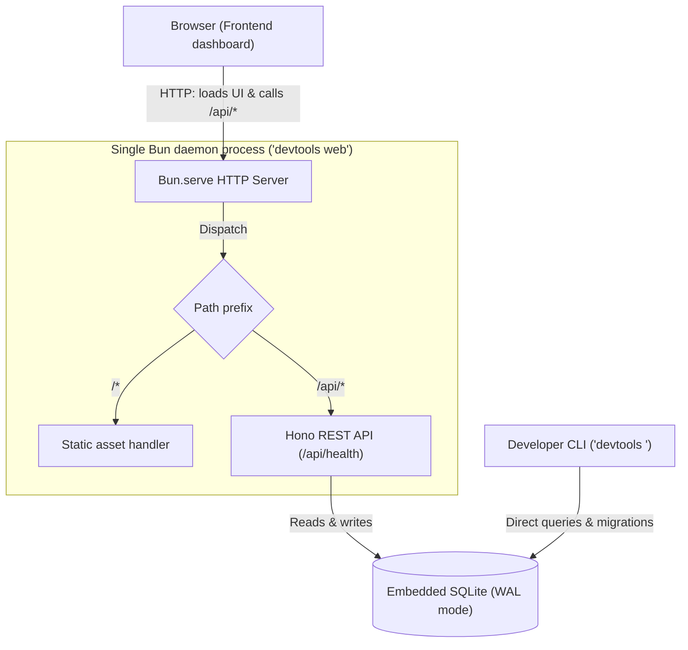
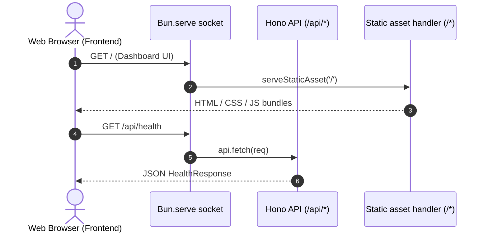

import { Accordion, Accordions } from "fumadocs-ui/components/accordion";
import { Callout } from "fumadocs-ui/components/callout";

The DevTools daemon consolidates background services, REST API endpoints, embedded persistence, and the web user interface into a single production process.

## Process topology

Traditional web applications separate the backend API service, frontend asset delivery, and database across distinct processes or containers. While suitable for large distributed cloud deployments, this topology introduces unnecessary friction for local developer tooling:

- Multiple TCP ports must be assigned, increasing the likelihood of port collisions with other local tools.
- Complex cross-origin headers and proxy configurations are required to link the browser frontend with the API backend.
- Independent process life cycles create orphaned services and zombie processes when a developer closes a terminal window.

DevTools resolves these challenges by using Bun to host all runtime concerns in a single operating system process:

The CLI launches the daemon process and manages OS termination signals. The CLI itself does not make HTTP requests or interact with the REST API. Only the web frontend dashboard running in the browser (or developer HTTP clients like cURL) communicates with the daemon over loopback HTTP. Both the in-process Hono REST API and standalone CLI commands access the embedded SQLite database directly, with concurrent transactions coordinated safely via SQLite WAL mode.

## In-process dispatch

All inbound HTTP requests enter through a single `Bun.serve` socket listener. The server inspects the incoming URL pathname to route between the Hono REST API and static frontend assets:

Requests prefixed with `/api` delegate directly to `api.fetch(req)` in memory. All other routes resolve static pre-compiled dashboard assets from disk. For endpoint schemas, see the [API specification](/docs/reference/api).

## Loopback security boundary

Local developer tools interact directly with developer disk storage and command execution environments. To prevent malicious web pages on the public internet from exploiting local services, DevTools maintains a strict loopback security boundary:

1. **Local interface binding**: The daemon binds strictly to loopback addresses (`127.0.0.1` or `localhost`). It never binds to `0.0.0.0` or public network adapters.
2. **CORS validation**: The Hono API verifies that incoming `Origin` headers originate strictly from `localhost` or `127.0.0.1`. Requests from external domains are rejected.
3. **Directory traversal prevention**: The static asset handler normalizes requested paths and ensures the target path is contained within the configured root directory. Any attempt to traverse above the base folder with `..` sequences triggers an immediate `403 Forbidden` response.

<Callout type="error" title="Loopback security boundary">
  Never bind the developer daemon to public network interfaces (`0.0.0.0`)
  without authenticated network proxies. The loopback restriction is an
  essential defense against drive-by request forgery from browser tabs.
</Callout>

## Lifecycle and signal management

The daemon manages startup initialization and termination through explicit lifecycle hooks:

<Accordions type="single">
  <Accordion id="startup-sequence" title="Startup initialization sequence">
    1. **Configuration validation**: The CLI validates options against `RuntimeConfigSchema`.
    2. **Port availability check**: The runtime confirms that the requested TCP port is unoccupied. If occupied in an interactive session, it prompts the operator with the next available port.
    3. **Database initialization and migration**: The daemon resolves the SQLite path according to execution context and applies pending Drizzle migrations.
    4. **Socket binding**: The Bun HTTP server binds to the validated interface and port.
  </Accordion>

  <Accordion id="graceful-shutdown" title="Graceful shutdown teardown">
    When the daemon process receives termination signals (`SIGINT` or `SIGTERM`), it initiates a clean teardown:

    1. The signal listener intercepts the operating system event.
    2. In-flight requests are allowed to complete.
    3. The server socket stops accepting new incoming connections.
    4. SQLite WAL journals are synchronized and database handles are closed cleanly.
    5. The process terminates with exit code 0.

  </Accordion>
</Accordions>

## Architectural trade-offs

The single-process loopback daemon architectural model involves deliberate trade-offs:

| Chosen approach                                 | Alternative design                                | Rationale and trade-off                                                                                                                                                         |
| ----------------------------------------------- | ------------------------------------------------- | ------------------------------------------------------------------------------------------------------------------------------------------------------------------------------- |
| Single Bun process hosting API and static files | Separate API server and static Next.js dev server | Eliminates port collisions and complex CORS configuration. Trade-off: frontend assets must be compiled prior to production daemon startup.                                      |
| In-process SQLite via `bun:sqlite` with WAL     | Standalone PostgreSQL or MySQL container          | Zero external installation prerequisites and microsecond query times. Trade-off: SQLite is scoped to local machine execution and does not support multi-machine clustering.     |
| Strict loopback binding (`127.0.0.1`)           | Public interface binding (`0.0.0.0`)              | Protects local system from browser-based drive-by attacks from public internet origins. Trade-off: requires SSH tunnels or port forwarding to share across local area networks. |
