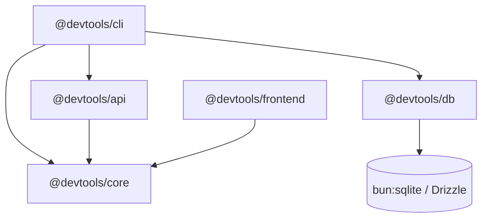

DevTools is structured as a monorepo workspace designed with strict architectural boundaries, explicit dependency contracts, and decoupled leaf packages.

## Workspace topology

The codebase separates runtime applications from reusable packages. Each leaf workspace defines its own package manifest, dependencies, and build lifecycle:

| Workspace directory | Package name         | Classification | Responsibility                                                                               |
| ------------------- | -------------------- | -------------- | -------------------------------------------------------------------------------------------- |
| `apps/cli`          | `@devtools/cli`      | Application    | Developer command-line interface, daemon lifecycle management, and port conflict resolution. |
| `apps/api`          | `@devtools/api`      | Application    | Hono REST API routing, loopback security boundaries, and HTTP response schemas.              |
| `apps/frontend`     | `@devtools/frontend` | Application    | React dashboard user interface built with Next.js and exported as static HTML/JS.            |
| `site`              | `@devtools/site`     | Application    | Fumadocs documentation platform and developer guide engine.                                  |
| `packages/core`     | `@devtools/core`     | Shared package | Shared Zod schemas, error definitions, and platform domain models.                           |
| `packages/db`       | `@devtools/db`       | Shared package | Embedded SQLite connection management, Drizzle schemas, and migration runners.               |

## Package boundaries and contracts

To prevent circular dependencies and tangled coupling, the monorepo enforces an acyclic dependency graph. Downstream applications depend on upstream shared packages, while shared packages remain completely isolated from application logic.



### Boundary invariants

1. **Shared core isolation**: `@devtools/core` contains pure TypeScript types and Zod schemas. It maintains zero dependencies on I/O, database drivers, or web framework runtimes.
2. **Generic persistence infrastructure**: `@devtools/db` manages connections, SQLite pragmas, and schema migrations. It does not house application-specific business logic.
3. **Public slice exports**: Each package exposes its public interface exclusively through its root `index.ts`. Internal implementation files remain encapsulated within package internals.

## Frontend architecture

The web dashboard (`@devtools/frontend`) adheres to Feature-Sliced Design (FSD) v2.1. FSD organizes frontend code into strictly ordered layers, preventing spaghetti dependencies as features grow.

### Layer hierarchy

The frontend source code under `apps/frontend/src/` is structured across three primary layers:

```text
apps/frontend/src/
├── app/               # Application-level providers, globals, and routing wrappers
├── pages/             # Composed view slices representing route pages
│   └── dashboard/     # Main developer dashboard view slice
└── shared/            # Reusable domain-agnostic modules and primitives
    ├── api/           # Typed HTTP client and query functions
    ├── lib/           # Utility helpers and custom React hooks
    └── ui/            # Design system building blocks and UI primitives
```

### Architectural rules

- **One-way dependency flow**: Modules may import only from layers positioned below them. For example, `pages/` may import from `shared/`, but `shared/` can never import from `pages/`.
- **Public API boundaries**: Every slice defines an `index.ts` file that acts as an explicit boundary. Cross-slice imports must target the slice public API rather than internal files.

## Persistence architecture (ADR-0001)

The persistence subsystem follows the decisions established in ADR-0001 (Embedded database foundation) documented in the [configuration and schema reference](/docs/reference/configuration). DevTools requires local persistence without the operational overhead of managing external database servers.

### Architectural highlights

- **Zero-configuration engine**: DevTools relies on Bun's built-in `bun:sqlite` engine for microsecond in-process SQL execution without external C++ compilation dependencies.
- **Drizzle ORM abstraction**: Type-safe schema definitions allow SQL queries to be fully typechecked at compile time while supporting automated schema migrations.
- **Write-Ahead Logging (WAL)**: All database connections enable `PRAGMA journal_mode = WAL`, allowing concurrent reads from CLI commands and the background daemon without database locking conflicts.
- **Context-aware path resolution**: Automated tests execute against `:memory:`, development builds store state in `<repo_root>/.devtools/devtools.db`, and packaged CLI releases use `~/.devtools/devtools.db`.
