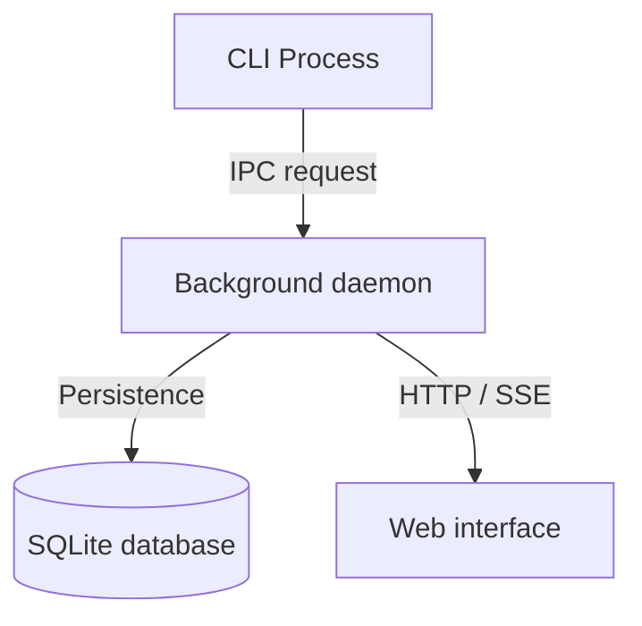

import { Card, Cards } from "fumadocs-ui/components/card";
import {
  GraduationCap,
  Wrench,
  Library,
  Lightbulb,
  Play,
  Terminal,
  TerminalSquare,
  Layers,
} from "lucide-react";

## Overview

DevTools provides unified developer workflows, an embedded loopback daemon, and web dashboard utilities across CLI and browser interfaces.

## Documentation quadrants

Navigate through platform documentation structured across the four Diátaxis quadrants:

<Cards>
  <Card
    icon={<GraduationCap className="size-4 text-[var(--tutorials-color)]" />}
    title="Tutorials"
    href="/docs/tutorials"
    description="Guided step-by-step learning path to install, configure, and run DevTools."
  />
  <Card
    icon={<Wrench className="size-4 text-[var(--how-to-color)]" />}
    title="How-to guides"
    href="/docs/how-to"
    description="Problem-oriented instructions for operational tasks and workflows."
  />
  <Card
    icon={<Library className="size-4 text-[var(--reference-color)]" />}
    title="Reference"
    href="/docs/reference"
    description="Technical specifications for CLI commands, REST endpoints, and schema definitions."
  />
  <Card
    icon={<Lightbulb className="size-4 text-[var(--explanation-color)]" />}
    title="Explanation"
    href="/docs/explanation"
    description="Architecture discussions on daemon topology, runtime boundaries, and design trade-offs."
  />
</Cards>

## Popular topics

Jump directly into key developer guides:

<Cards>
  <Card
    icon={<Play className="size-4 text-[var(--tutorials-color)]" />}
    title="Getting started"
    href="/docs/tutorials/getting-started"
    description="Clone the repository, build frontend bundles, and start the daemon."
  />
  <Card
    icon={<Terminal className="size-4 text-[var(--how-to-color)]" />}
    title="Start daemon"
    href="/docs/how-to/start-daemon"
    description="Custom port bindings, host flags, and static directory mounting."
  />
  <Card
    icon={<TerminalSquare className="size-4 text-[var(--reference-color)]" />}
    title="CLI reference"
    href="/docs/reference/cli"
    description="Options, environment variables, exit codes, and usage examples."
  />
  <Card
    icon={<Layers className="size-4 text-[var(--explanation-color)]" />}
    title="Runtime stack"
    href="/docs/explanation/runtime-stack"
    description="Monorepo topology, package boundaries, and Feature-Sliced Design."
  />
</Cards>

## System architecture

