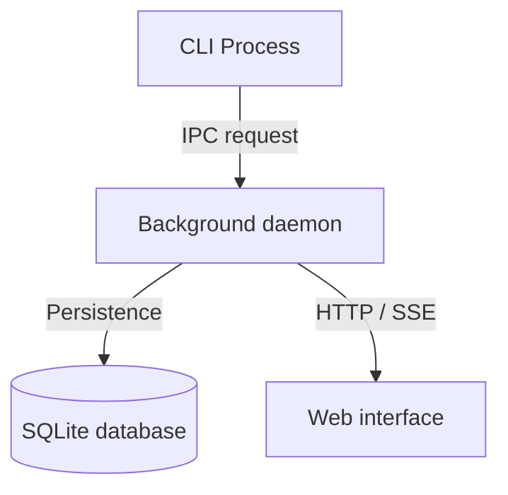

import { Card, Cards } from "fumadocs-ui/components/card";
import {
  GraduationCap,
  Wrench,
  Library,
  Lightbulb,
  Play,
  Terminal,
  TerminalSquare,
  Layers,
} from "lucide-react";

## Platform overview

DevTools provides unified developer workflows, an embedded loopback daemon, HTTP APIs, and dashboard utilities across CLI and browser interfaces. It eliminates fractured configurations by establishing a single production Bun runtime process for local developer tooling.

## Documentation quadrants

DevTools documentation is organized using the Diátaxis framework across four distinct quadrants, each serving a specific developer mindset:

<Cards>
  <Card
    icon={<GraduationCap className="size-4 text-[var(--tutorials-color)]" />}
    title="Tutorials"
    href="/docs"
    description="Learning-oriented guides. Step-by-step paths from clean checkout to a fully functioning local developer environment."
  />
  <Card
    icon={<Wrench className="size-4 text-[var(--how-to-color)]" />}
    title="How-To Guides"
    href="/docs/how-to"
    description="Problem-oriented instructions. Actionable procedures for running the daemon, managing databases, and operational workflows."
  />
  <Card
    icon={<Library className="size-4 text-[var(--reference-color)]" />}
    title="Reference"
    href="/docs/reference"
    description="Information-oriented technical specs. Exact CLI flags, REST endpoints, and schema definitions."
  />
  <Card
    icon={<Lightbulb className="size-4 text-[var(--explanation-color)]" />}
    title="Explanation"
    href="/docs/explanation"
    description="Understanding-oriented discussions. Daemon architecture, loopback topology, runtime boundaries, and design trade-offs."
  />
</Cards>

## Popular topics

Jump directly into key developer guides across the platform:

<Cards>
  <Card
    icon={<Play className="size-4 text-[var(--tutorials-color)]" />}
    title="Getting started with DevTools"
    href="/docs/getting-started"
    description="Clone the monorepo, build frontend assets, start the loopback daemon, and verify health."
  />
  <Card
    icon={<Terminal className="size-4 text-[var(--how-to-color)]" />}
    title="Configure and start daemon"
    href="/docs/how-to/start-daemon"
    description="Custom port bindings, host flags, conflict resolution, and static asset serving."
  />
  <Card
    icon={<TerminalSquare className="size-4 text-[var(--reference-color)]" />}
    title="CLI reference"
    href="/docs/reference/cli"
    description="Options, subcommands, exit codes, and environment variables."
  />
  <Card
    icon={<Layers className="size-4 text-[var(--explanation-color)]" />}
    title="Runtime stack"
    href="/docs/explanation/runtime-stack"
    description="Monorepo topology, package boundaries, and Feature-Sliced Design v2.1."
  />
</Cards>

## System architecture

The following diagram illustrates the interaction between the CLI process, the background daemon, SQLite persistence, and the web interface:

