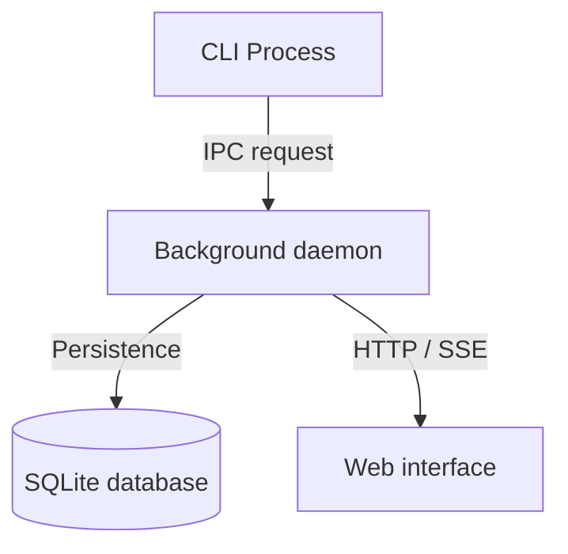

import { Card, Cards } from "fumadocs-ui/components/card";

## Overview

DevTools provides unified developer workflows, an embedded loopback daemon, and web dashboard utilities across CLI and browser interfaces.

## Documentation quadrants

Navigate through the platform documentation structured across the four Diataxis quadrants.

<Cards>
  <Card
    title="Tutorials"
    href="/docs/tutorials"
    description="Guided step-by-step learning path to install, configure, and run DevTools."
  />
  <Card
    title="How-to guides"
    href="/docs/how-to"
    description="Problem-oriented instructions for operational tasks and workflows."
  />
  <Card
    title="Reference"
    href="/docs/reference"
    description="Technical specifications for CLI commands, REST endpoints, and schema definitions."
  />
  <Card
    title="Explanation"
    href="/docs/explanation"
    description="Architecture discussions on daemon topology, runtime boundaries, and design trade-offs."
  />
</Cards>

## System architecture

